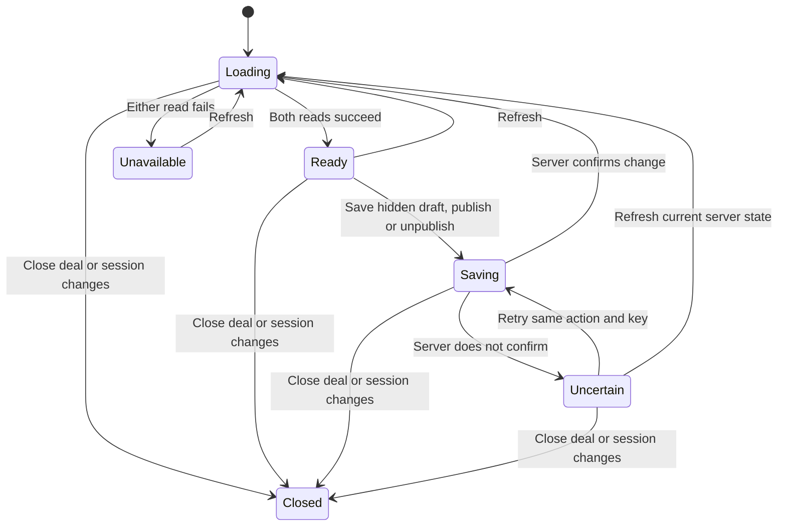

# Client view tab

Card: WR586.S4.J15

## System design

CARR at c22e8b9ea0986eeb72347d4f70a20f3bfd21daac owns publication versions, authorization and the exact client projection. The React island owns transient form and request state. The workspace injects the authenticated MCP transport. Synthetic mode uses a typed fake pinned to that revision, never a production fallback.

Two alternatives were considered. Rendering partner drafts with local visibility filtering would duplicate privacy and file-version rules. Rendering only preview-deal-client-view avoids that duplication and is chosen. Partner drafts remain in a separate authoring region.

Capacity and scaling: one publication list (at most 1000 records), one finalized deliverable list (100 files) and one preview (100 publications and 100 legacy materials) per tab load. At 10x concurrent partners CARR handles the aggregate; no per-item calls or N+1. First limit is CARR availability; the UI refuses malformed/oversized results.
Load spread: three independent reads run in parallel, no polling. Caching: none, refresh replaces data and hides old preview. Invalidation on session change/disposal aborts and fences late responses.
Availability and consistency: either failed read hides the whole view. Writes disable all other writes, never update preview optimistically, and reload all reads after confirmation. Unknown write outcomes keep the exact command and idempotency key for explicit retry. Version conflicts require refresh, never blind overwrite.
Async: n/a, no queue or background sends. External call circuit breaker: one failed load stops calls until explicit refresh. One unknown write stops new mutations until explicit same-key retry or refresh. Ten-second MCP deadlines, no automatic retries. Rate bounds: one read pair or one write active per panel; list and projection caps validated. No fan-out loop.
Idempotency: random key once per explicit write, retained for unknown-outcome retry. Publication UUID remains stable across retries. SQL CAS owns conflict resolution.

## Statechart

No publication occurs from mount, preview, refresh or typing. Preview contains only server projection, including already shared legacy materials. Draft saving always sets published=false. Published items change only through explicit publish or unpublish buttons. Tour text can be published but tours are never edited here.

## Throughput checkpoint

- Blocking first steps: live WR acceptance, pinned CARR contract, main and overlap inspection.
- Independent workstreams: n/a, one worker and no delegates authorized.
- Shared mutable state: one panel command; CARR owns revisions across partners.
- Smallest safe decomposition: client tab only; portal hosting and tour editing remain separate units.

## Design and debt pass

codebase-design: one mount/refresh/dispose interface hides read coordination and command retry state. Transport injection is a real seam with live MCP and synthetic adapters. Rejected local draft filtering because it duplicates CARR privacy rules.
zero-tech-debt: no legacy publication implementation exists to delete. No polling, compatibility renderer, optimistic visibility or app-owned business records added. Type System Discipline parses untrusted transport data once; Model the Domain uses a discriminated state union instead of independent status flags.

## Contract binding and file versions

Recovered from retained app revision 65d066fbfede0d34c6a1600d9f8f1f40752d2334. The copied 1.1.0 contract and its SHA-256 are in contracts/client-publications.v1/source.json. No CARR source changes belong to this PR.

A deliverable command contains its file ID and exact integer deliverable_version. Publishing from Finalized files uses the freshly loaded file version. Withdrawal uses the version retained in the publication list, including when the file later becomes private or stale. CARR alone decides which rows the preview and client read expose. The client reader accepts the new empty roadmap and explicit publications while preserving legacy URL/password/lock behavior.

Known server refusals show fixed hints and require refresh. Unknown outcomes retain the complete command and key. The formal model adds a receipt state independent of loading, with guards matching save and receipt handling. It abstracts UUIDs, SQL authorization, file bytes and numeric versions. Executable tests cover the actual numeric version checks.

## Transition tests

- Loading to Ready and Ready to Saving to Loading. `CLIENT-VIEW hides drafts until explicit publish and removes withdrawn content`.
- Loading to Unavailable, Unavailable to Loading and Ready to Loading. `read failures hide preview, refresh retries, session invalidation fences late results`.
- Saving to Uncertain and Uncertain to Saving. `unknown write outcome retains same key and stops new writes until explicit retry`.
- Uncertain to Loading and invalid receipt version to Uncertain. `uncertain refresh reconciles and rejects mismatched receipt versions`.
- Saving to Refused and Refused to Loading. `authoritative refusal stops writes, shows a fixed hint, and refreshes versions`.
- Loading, Ready, Saving, Uncertain, Unavailable and Refused to Closed. `every active state closes on session invalidation and fences pending work`.
- Publication receipt Unconfirmed to Confirmed and next write back to Unconfirmed. `refreshed files publish their current exact version; withdrawal keeps the stored version` and the mismatched-receipt test.

## Verification

Regenerate TLC in a scratch directory after copying the chart, J15Chart.tla and J15Chart.cfg together. First generate the mapping from the chart in scratch, then restore the guarded TLA model. Run statechart.mjs from-chart client-publications.mmd --module J15Chart with JAVA and TLA2TOOLS set. The explicit guards restrict receipt and save events to the active request states. The unguarded chart deliberately shows more possibilities than the implementation.

Run node --test test/client-publications.test.ts test/client-publication-version.test.ts test/client-publications.browser.ts test/client-publications-proof.browser.ts. Browser fixtures compile the current source before serving it.

## Production proof

scripts/prove-client-publications.ts takes --origin, --commit, --carr-origin, --carr-commit, --deal, --cdp-url, --evidence and --timeout-ms. The evidence JSON contains client_read from an existing independently authorized client read, receipt with id/version/published from an existing publication or withdrawal, hidden_canaries from known hidden milestones and private/foreign files, and carr_checkout for ancestry checks. It never requests or reads a portal password. Keep private evidence outside the repository.

The proof checks containing CARR and app releases, reads the real partner preview in a borrowed signed-in browser at 1440 and 390 in light and dark, compares exact displayed fields against the independent projection, checks canary absence and the stored receipt, and refuses overflow. It never publishes or withdraws. Exit 0 means all assertions passed, 1 means an assertion failed on containing releases, and 78 means insufficient evidence. A public password walk remains separate authorized work. Proof fixtures cover pass, near-miss failure, noncontaining release and unavailable session. Independent taste scoring and deployed persistence remain coordinator review/proof work.
