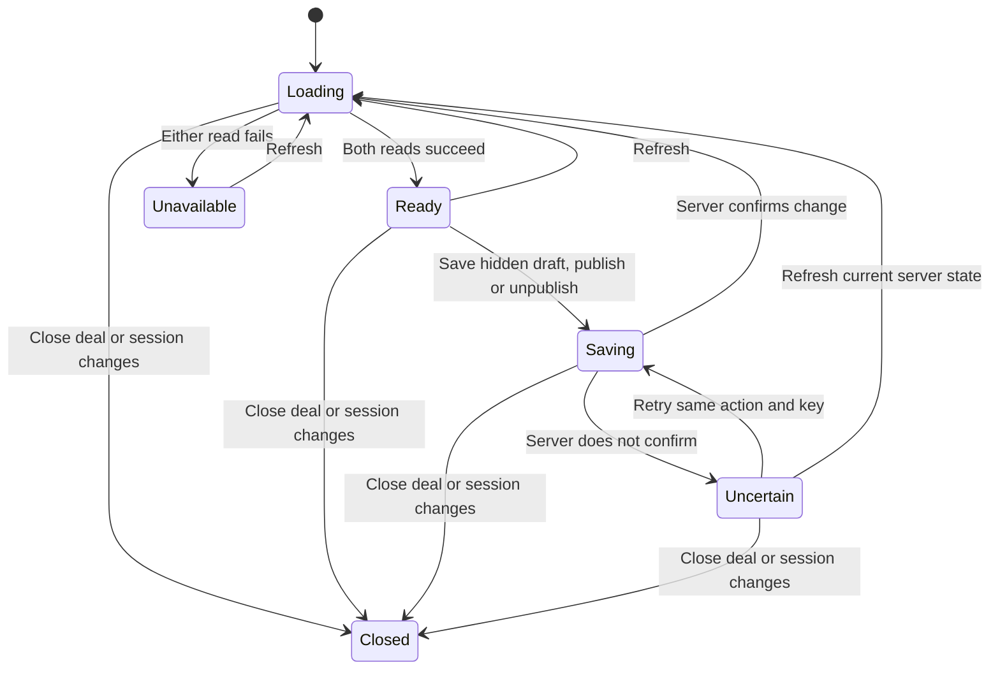

# Client view tab

Card: WR586.S4.J5

## System design

CARR at 541e47ffce83bbd6cb591545417be0dd91a3ea0c owns publication versions, authorization and the exact client projection. The React island owns transient form and request state. The workspace injects the authenticated MCP transport. Synthetic mode uses a typed fake pinned to that revision, never a production fallback.

Two alternatives were considered. Rendering partner drafts with local visibility filtering would duplicate privacy and file-version rules. Rendering only preview-deal-client-view avoids that duplication and is chosen. Partner drafts remain in a separate authoring region.

Capacity and scaling: one list (at most 1000 records) and one preview (100 publications and 100 legacy materials) per tab load. At 10x concurrent partners CARR handles the aggregate; no per-item calls or N+1. First limit is CARR availability; the UI refuses malformed/oversized results.
Load spread: two independent reads run in parallel, no polling. Caching: none, refresh replaces data and hides old preview. Invalidation on session change/disposal aborts and fences late responses.
Availability and consistency: either failed read hides the whole view. Writes disable all other writes, never update preview optimistically, and reload both reads after confirmation. Unknown write outcomes keep the exact command and idempotency key for explicit retry. Version conflicts require refresh, never blind overwrite.
Async: n/a, no queue or background sends. External call circuit breaker: one failed load stops calls until explicit refresh. One unknown write stops new mutations until explicit same-key retry or refresh. Ten-second MCP deadlines, no automatic retries. Rate bounds: one read pair or one write active per panel; list and projection caps validated. No fan-out loop.
Idempotency: random key once per explicit write, retained for unknown-outcome retry. Publication UUID remains stable across retries. SQL CAS owns conflict resolution.

## Statechart

No publication occurs from mount, preview, refresh or typing. Preview contains only server projection, including already shared legacy materials. Draft saving always sets published=false. Published items change only through explicit publish or unpublish buttons. Tour text can be published but tours are never edited here.

## Throughput checkpoint

- Blocking first steps: live WR acceptance, pinned CARR contract, main and overlap inspection.
- Independent workstreams: n/a, one worker and no delegates authorized.
- Shared mutable state: one panel command; CARR owns revisions across partners.
- Smallest safe decomposition: client tab only; portal hosting and tour editing remain separate units.

## Design and debt pass

codebase-design: one mount/refresh/dispose interface hides read coordination and command retry state. Transport injection is a real seam with live MCP and synthetic adapters. Rejected local draft filtering because it duplicates CARR privacy rules.
zero-tech-debt: no legacy publication implementation exists to delete. No polling, compatibility renderer, optimistic visibility or app-owned business records added. Type System Discipline parses untrusted transport data once; Model the Domain uses a discriminated state union instead of independent status flags.

## Verification limits

The statechart was authored before implementation. from-chart generated TLA+ but TLC is unavailable, so no formal proof or generated chart PNG is claimed. Executable tests cover publication visibility, retries, malformed reads, null portal, session changes, disposal and draft save. Existing hosting consumers and production persistence are separate dependencies, unverified by this synthetic run. File bytes and file download capabilities are outside the pinned contract; the preview displays only safe file metadata.
