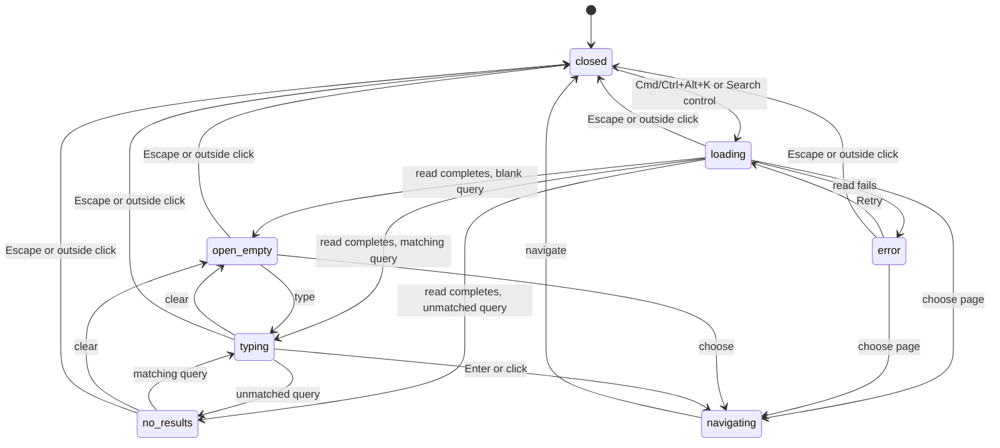

# Quick switcher

Card: WR617.S11.J3

Control Room keeps Cmd/Ctrl+K, exactly as on main. Doc keeps Cmd/Ctrl+D.
The global switcher uses Cmd/Ctrl+Alt+K. Its button advertises the same shortcut.
Cmd/Ctrl+Shift+K was rejected because Edge on Windows reserves it for Duplicate
Tab. The Alt variant is unused by app keydown handlers and is not listed in the
published [Chrome](https://support.google.com/chrome/answer/157179),
[Safari](https://support.apple.com/guide/safari/keyboard-and-other-shortcuts-cpsh003/mac)
or [Edge](https://support.microsoft.com/en-us/edge/keyboard-shortcuts-in-microsoft-edge)
shortcut tables. Safari coverage applies to macOS. Chrome and Edge tables cover
macOS and Windows. User remappings and extensions can still claim shortcuts.
The handler uses physical KeyK so Option-generated characters on macOS work.
Composition events, including keyCode 229, and AltGraph pass through. Printable
Ctrl+Alt characters in editable fields also pass through. Composing Enter
never chooses a destination.

The switcher is a lazy island over the authorized board, relationship network
and navigation registry. Recents retain only destination IDs in session storage
and intersect them with fresh reads. Labels are never persisted.

Close always restores the opener. Session invalidation closes and retires the
island, clears recents and discards late reads. New opens revalidate data.
Arrow keys wrap while focus stays on the combobox. Native dialog excludes background Tab targets.

Two designs were considered. The full Search page preserves broad search but
its producer does not supply navigable deal links. The chosen local index gives
instant filtering over existing navigable reads without a new server contract.
Board actions supply task destinations. Contacts open their relationship node.
The model excludes transport and destination authorization checks, which remain
with the authenticated adapters and destination pages.

Named regression coverage in `test/quick-switcher-browser.test.mjs`:

- `held read completes with needle/absent query and clears to pages` covers delayed matching, delayed no-results and clearing to pages.
- `<phase> closes with Escape/outside and restores focus` covers both close paths in loading, error, open_empty, typing and no_results.
- `loading/error page result navigates with Enter` covers available page navigation before a successful record read.
- `arrow selection wraps exactly and Tab excludes background controls` covers both arrow directions, wrapping and focus containment.
- `global switcher preserves <variant> text entry` covers AltGraph, printable editable fields and both composition signals.
- `composing Enter preserves switcher before normal Enter` covers the composition self-transition and ordinary navigation afterward.

## Exact task destinations remain blocked on source identity

Board task results currently open their owning deal. Two results from one deal
have distinct recent IDs but the same destination.

The board contract does not prove that an open action ID belongs to
`next_action`. At CARR revision
`6c6ed9648bc56f7a3479522d48d66fab274e691d`, the registered board producer in
`mcp-server/src/tools.js` selects open unstructured actions from
`v_deal_room_action`. Migration `0936_deal_alert_items.sql` defines that view
as a union of `next_action` and `capture_post_call_action`. The board returns
only `id`, `owner`, `description`, and `due_on` for each action.

Home's projection in migration `1136_home_inbox_projection.sql` uses
`next_action:<UUID>` and `capture_post_call_action:<UUID>` as different card
identities. Prefixing every board action with `next_action:` can therefore
produce a nonexistent card. A UUID format check cannot distinguish the tables.
Structured deal items are separate from these unstructured actions.

The next implementation needs a producer-owned canonical card identity for
each open action, or an authenticated resolver that determines that identity.
Joining only the loaded Home snapshot cannot handle a task outside that
snapshot. The destination must retain Home's explicit unavailable-card behavior
when the task disappears or resolves before navigation.

The partial branch for `WR617.S1.J246` retains a failing browser regression in
`test/quick-switcher-kind-filter-browser.test.mjs`. It observes pointer and
Enter selections for two task identities from one deal. Both navigate to the
same deal URL. Its expected next-action routes describe the intended case for
known next actions, not proof that every board action is a next action.
