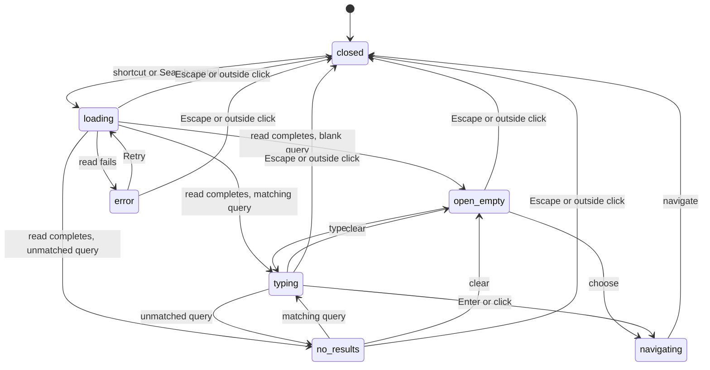

# Quick switcher

Card: WR617.S11.J3

The switcher is a lazy island over the authorized board, relationship network
and navigation registry. Recents retain only destination IDs in session storage
and intersect them with fresh reads. Labels are never persisted.

Close always restores the opener. Session invalidation closes and retires the
island, clears recents and discards late reads. New opens revalidate data.
Arrow keys wrap while focus stays on the combobox. Native dialog contains Tab.

Two designs were considered. The full Search page preserves broad search but
its producer does not supply navigable deal links. The chosen local index gives
instant filtering over existing navigable reads without a new server contract.
Board actions supply task destinations. Contacts open their relationship node.
The model excludes transport and destination authorization checks, which remain
with the authenticated adapters and destination pages.
