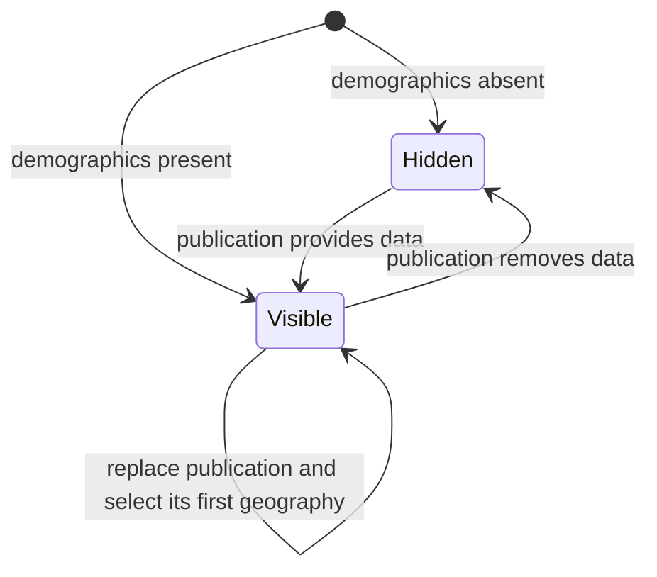

# Demographics core

Card: WR227.S12.J1

Size is medium. One injected React module owns growth, age, median income and
income-band presentation. S10 owns loading, validation, routing and bundling.
Base main is 28a1a144cc6659b83617a19f06f504332570fe38. The source contract is
DoctorCRE/carr-system 865fefee26fcbbe50a04c7515c5f3d3bc8913cd1, including the
standard-site design, market-study.v1 schema, synthetic package and parity probes.
Current main has no src/ui/portal directory or demographics implementation.

## System design

Architecture. DemographicsCore accepts already validated demographics data.
A structural core projection accepts S10's Demographics type without importing
its unmerged branch. Register only when data exists. Load
portal/demographics-core.css with the shell stylesheet, and render
`<DemographicsCore demographics={publication.demographics} />`.
No common router, loader, package validator or bundle is added here.

Capacity and scaling. Projection compares labels for disambiguation in quadratic
time. Subsequent rendering is linear in package rows. Tests exercise current
and 10x synthetic row counts. No repeated remote reads or N+1 queries occur.
Load spread and storage. n/a, injected immutable data only.
Caching. A WeakMap retains one projection per immutable publication object.
It releases
the projection when the publication is unreachable. A new publication object
gets a fresh key namespace and falls back to its first geography, even if its
labels and row positions match the previous publication.
Availability and consistency. Absent data hides the module. Unmatched geography
rows and missing threshold counts display Unknown. No interpolation or zero fill.
Async, queues, circuit breakers, rate limits and write idempotency. n/a, no
external calls, writes or sends. Source anchors open on user activation.
DOM tests reject unexpected network calls during interaction.

Separate props for every chart would make the caller join geographies and
sources. One demographics prop keeps that join local. Growth and household
selectors remain independent because published lists can differ. Age and median
income share household selection. Thresholds update all household cards together.

## Statechart

State contains package-owned growth and household keys and a threshold.
A key contains the publication object, its session namespace, section and row
position. Repeated projection of the same immutable object returns the same
keys. A separately parsed object gets new keys, even for identical content.
Keys identify rows within this publication, not persistent geographic entities.
Values and sources stay on the projected row selected by that key.

Age and median rows pair only at the same position with agreeing published
names. Name equality is a consistency guard, never a lookup key. When positions
disagree, both rows remain separately selectable with Unknown for the missing
measure. Reordered lists are not joined by name. Same-named rows retain separate
positions and ordinal labels. The explicit geography-ID schema is a queued
follow-up, outside this component and S10's unchanged loader.

Considered two shapes. Independent age and median selectors would eliminate
pairing but change the household interaction. The chosen projection retains
one household selector while keeping keys, values and sources together.
The Model the Domain principle removed name-based state and the income Map.
Type System Discipline uses a structured GeographyKey instead of a string name.

The bounded TLA+ model checks package-owned position membership and replacement
with the same display names. It abstracts stored selection into its resolved
value. It does not prove React rendering or cross-section correspondence.
The browser tests exercise all chart transitions, including duplicate selection
and publication replacement at the same selected position in all four layouts.
Projection tests cover stable keys, package isolation, mismatched positions and
labels that already contain ordinals. The Prove It Works principle requires the
browser regression, not the bounded membership model, as defect evidence.

The pinned schema has no explicit core age year, age population count,
median-income source URL or income year. Preserve household notes, income
captions and methodology rather than inventing facts. The median section labels
the age source as household context, with general methodology alongside it.

## Remaining proof

Synthetic tests do not establish private-reference visual parity. The assigned
rows need the Studio parity run, including V-A07 and V-A08. S15 owns micro-zones
and competition. Production proof requires shell integration and a published
portal. Select two geographies and a threshold, then compare values,
denominators, years and source links with the publication without charts.

## Design and debt pass

codebase-design keeps one injected data seam and local geography joins. No
caller must coordinate a value with a separate source state.
zero-tech-debt reuses the existing theme tokens and leaves router, loader and
bundling with S10. The diff adds a new module, synthetic fixture and tests;
there is no existing demographics implementation to delete. No code comments,
casts, suppressions or compatibility modes were introduced.
