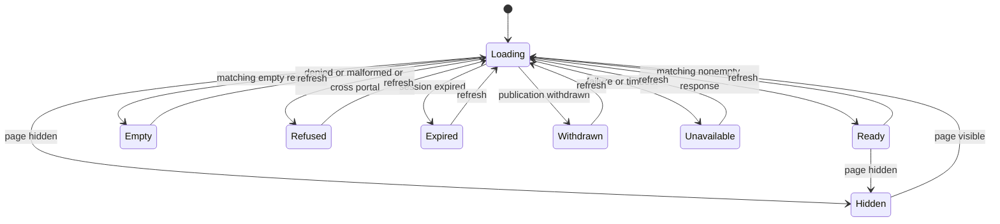

# Documents reader

Card: WR227.S17.J1

Medium, one session. Main at 28a1a144cc6659b83617a19f06f504332570fe38
has a partner portal client but no client Documents module.

## Grounding and alternatives

CARR owns authorization and explicit sharing. This module owns transient UI.
Authoritative CARR revision 865fefee26fcbbe50a04c7515c5f3d3bc8913cd1 pins
docs/client-portal/standard-site-design.md S17, mcp-server/src/client-portal.ts
and migrations/0975_client_portal.sql. client-portal.v1 returns slug, roadmap
and materials with kind, title and content. document is a document; report and
tour are generated deliverables. The study schema, fixture and parity probes
describe study content, not material authority. No study assets become Documents.

Considered a transport-owning view and an injected view. The former would
couple public login to partner MCP or invent routes. Chosen interface is
Documents with portalSlug, sessionScope and transport. The transport returns
received with the raw v1 envelope, or refused, expired, withdrawn or unavailable.
These are local UI outcomes, not new wire fields. The adapter must not return
cached data. sessionScope changes on login, logout or authorization invalidation.
S9 owns that adapter and S10 owns mounting, routing, styling and bundling.

## System design

- Architecture. One module validates the received envelope and renders text.
  The injected transport owns auth, same-origin no-store requests and HTTP mapping.
  Tests prove only explicitly returned material is rendered.
- Capacity. One request per mount or refresh, at most 100 materials, 200 title
  characters and 10,000 content characters each after trimming ASCII spaces,
  matching PostgreSQL btrim in v1. Original text is preserved. Bounds and padding
  are tested. Tabs and other non-space code points count toward the limit.
  At 10x sessions upstream authorization breaks first, not per-item fan-out.
- Load spread and scaling. No polling, retries, per-item reads or fan-out.
  Refresh is disabled while loading. A held-request test checks call count.
- Cache. No shared or persistent cache. Refresh clears before reading, scope
  changes remount, and hidden pages abort and clear. Visible pages reread.
  Late aborted completions cannot restore text. Browser tests cover these paths.
- Availability and consistency. One sequential read. A failure or ten-second
  timeout shows unavailable and drops material. Fresh responses replace the
  whole list. Refused, expired and withdrawn never serve stale text.
- Storage and N+1. n/a, no storage access or per-item calls.
- Async. One promise with abort and a completion guard, no queue.
- Circuit breaker. One failure stops the attempt. No automatic retry. UI status
  signals failure without logging credentials or content. Timeout is tested.
- Rate limits. One read in flight, no loops; another attempt requires a refresh
  or visibility return. Adapter/server limits remain owned by S9.
- Writes and idempotency. n/a, no upload, send or write.

## Statechart

Any state can unmount. Unmount aborts and ignores late completions. A new portal
or session starts Loading synchronously. Browser transitions cover each outcome,
refresh removal, session changes, late resolution, visibility and timeout.
The chart is a design artifact, not a claim of TLC verification.

## Delivery limits and production proof

File actions stay unavailable. No file URL, download authority or file transport
is invented. React escapes text; even URL-shaped content remains plain text.
Refreshed authorization removes withdrawn text. Instant revocation of already
displayed text requires an adapter invalidation signal; this unit cannot prove it.
After S9 and S10 integration, production proof compares the shared list and one
released file to publication, checks an already-withdrawn item, and denies its
fetch from a second portal session. This worker makes no production calls.

Throughput checkpoint. Contract inspection blocks implementation. There are no
independent workstreams or shared mutable files. One reader and its tests are
the smallest safe decomposition. No subagents, merges or sibling edits.

## Round-two parser correction

Card: WR227.S17.J4

Small parser-only fix. The existing received-envelope and material union remain
the data shape. No transport, caching, concurrency or storage behavior changes.

The pinned producer filters publication and portal ownership before returning
materials. Every returned item must satisfy its kind and btrim length constraints.
An item violating those constraints makes the response inconsistent with that
producer, so the reader refuses the whole response rather than presenting a
partial trusted list. Valid padded entries preserve all unrelated entries.
Unknown fields remain discarded by projection. URL-shaped text stays literal;
unknown download fields never grant file authority. The reader cannot independently
verify publication or deal ownership beyond the matching portal slug.

Throughput checkpoint. Run the parser and DOM regressions before the one-function
fix, then local checks and the four width/theme combinations. Hosted validation
runs after the final push. No independent work or subagents are needed.
