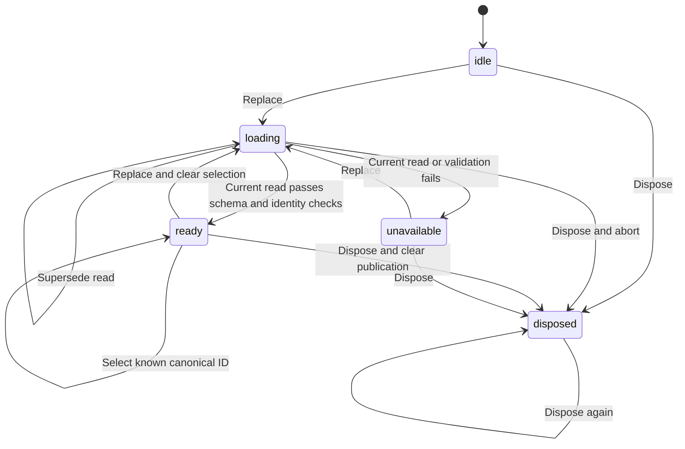

# Geography loader

## System design

This medium build owns package types, identity parsing and publication replacement. The demographics renderer remains with app PR 667. The shell remains with app PR 665. Main has no shell package module yet. This branch freezes its package types and test dependency from PR 665 head 404d69b038411e70db78cb258fd3f10238289cbc.

The v1 schema and synthetic package retain CARR pin 865fefee26fcbbe50a04c7515c5f3d3bc8913cd1. The proposed v1.1 schema and same-name overlay retain producer pin edd0439778542302ae24c72c858ac27d39c3d82a. Integration must pin the landed producer later.

The adapter supplies a full-schema type guard to parseMarketStudy. It must validate the full package against the selected pinned schema without coercion, defaults or property removal. The parser then checks cross-section identities and returns an ID-keyed core projection. Tests use the pinned schemas through Ajv. The injected read owns fetching and authentication.

Two interfaces were considered. Returning only wire rows leaves joins and replacement selection to every consumer. The chosen loader publishes a single discriminated state containing revision, package, projection and selection. Names and positions never determine identity. Legacy packages have an explicit legacy projection with no canonical selection. Unknown versions fail. Flexible pages remain the renderer's concern.

Replacement clears the previous publication immediately. A generation counter refuses superseded responses even when the adapter ignores cancellation. A failed read or parse publishes only unavailable state. Selection accepts only IDs in the current projection. Successful replacement resets selection. Repeated selection and disposal are idempotent. Repeated replacement starts a fresh read.

Maps and sets make parsing linear in row count and memory, also at 10x package size. A structured clone separates published state from adapter-owned input. No cache survives replacement. There is no database access, N+1 query, queue, retry, external fan-out, write or send. The adapter owns request capacity and transport cancellation. Rendering capacity stays with the consumer.

## Statechart

Late results and unknown selection leave state unchanged. Tests derive from replacement, success, refusal, late-response and disposal transitions. TLC was not run. The statechart runner installs tools, which this job forbids.

## Throughput checkpoint

- Blocking first steps. Freeze producer fixtures and reproduce missing loader behavior.
- Independent workstreams. Not applicable. One loader owns package and selection consistency.
- Shared mutable state. One instance owns one generation and one state. No global publication state.
- Smallest safe decomposition. One worker implements parser and replacement tests. Renderer integration follows its owner.

## Consumer interface

CarrMarketStudy is the versioned wire union. CarrMarketStudyV1 remains the exact legacy type. CoreGeography contains geography_id, geography_label and all four rows joined by ID. A ready state's selectedGeographyId belongs only to that state's projection. Legacy packages expose no canonical selection.

This is an exported integration seam. It does not change the pending shell's mountPortal or the demographics renderer. Their owner must connect the full-schema adapter, loader state and renderer after holders land.

## Production proof

Pending producer and consumer delivery. Open an authorized existing publication, read its revision, select distinct same-named geographies, and confirm charts and sources follow each canonical ID. Repeat after a fresh publication load. Do not create a publication. Until this passes the product remains landed-unproven.
