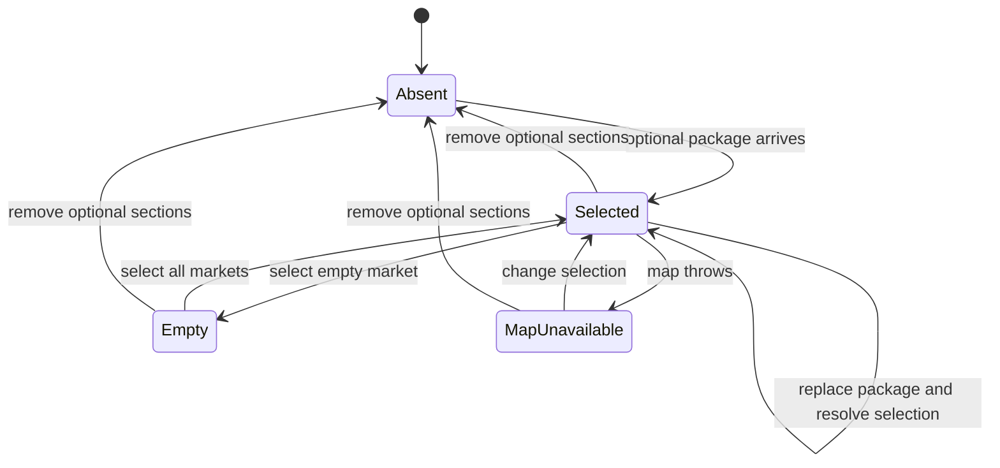

# Optional micro-zones and competition

Card: WR227.S15.J1

## System design

Source contract is DoctorCRE/carr-system 865fefee26fcbbe50a04c7515c5f3d3bc8913cd1, standard-site-design.md D2, D15 and S15, market-study.v1.schema.json, synthetic fixture and probes.v1.json. Live map-architecture returned 1.2.0. Main inspected at 28a1a144cc6659b83617a19f06f504332570fe38 lacks these modules. S12 PR 667 exposes DemographicsCore with a demographics prop. S10 PR 665 owns parsing, routing, MapLibre and bundling.

Architecture. MicrozonesCompetition accepts validated optional sections. Schema-derived types preserve optional reported percentages. A selected zone supplies all fields in one render. An injected renderMap accepts that same zone or filtered offices. The shell owns actual map resources. Regional demographics remains S12's responsibility.

Alternatives. Importing S10 types before its merge breaks main compilation. A generic report renderer hides denominators and field meaning. Chosen design uses a schema-derived optional projection and explicit sections. S10's types structurally satisfy the interface. No sibling files are edited.

Capacity and scaling. One O(n) office filter per interaction, one selected zone render, no request fan-out. Ten times the fixture remains one pass; DOM volume breaks first. No cache, storage access, N+1 queries, queues, timers, writes or sends. No idempotency key or external-call rate limit applies because no effect is issued. Data comes from one loaded immutable publication. Package replacement resolves invalid zone IDs to the first row and invalid markets to all markets. Tests cover replacement and ten-times fixture size.

Availability. Injected maps render inside an error boundary. One render exception opens the breaker for that selection and displays an unavailable message. A changed selection resets it once. Directory and report tables remain mounted. No retry loop or external alert channel. Failed logos hide while names remain. Tests cover failure, recovery and missing adapters. Same-origin hash assets are the only image requests.

Consistency. Radius, center, source hash and page, timestamp, years and denominators derive from the same selected zone. Reported and derived percentages occupy separate columns; neither is recomputed. Competition markets come directly from the package, including an empty market. Office identity uses name, address and source_url because schema v1 has no office ID. Filter order and marker number never enter identity. Introducing canonical IDs requires an upstream schema change.

## Statechart

Browser transition tests exercise reverse zone switching, package replacement, empty filters and map recovery. Pins are analytical locators and never generate navigation. The model leaves provider behavior to S10's adapter.

## Integration and proof

Mount MicrozonesCompetition with microZones=package.demographics.micro_zones and competition=package.demographics.competition. Include portal/microzones-competition.css after shell styles. Supply renderMap with S10's MapLibre adapter. Routing, bundling and actual MapLibre integration remain a coordinator follow-up after holders merge.

Assigned rows are A-S32, A-S33, A-S46, A-T22..A-T31, A-L17, A-L56..A-L75, A-A27..A-A33, A-A35..A-A37. Tests prove synthetic behavior and file references, not private reference-site pixel parity or released asset bytes. Studio Stage 2 parity remains required.

Production proof remains required after integration and deployment. Switch zones and filters in a publication with optional data. Compare figures, geometry and source pages with the selected package row. Try an empty market and unavailable map. This worker makes no production calls.
