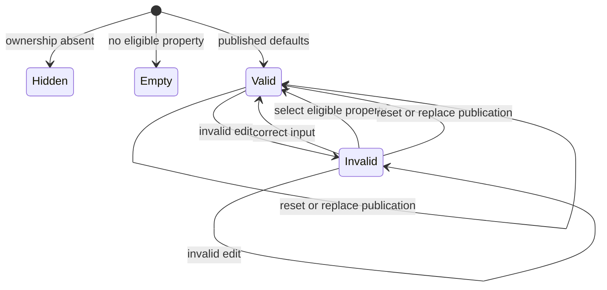
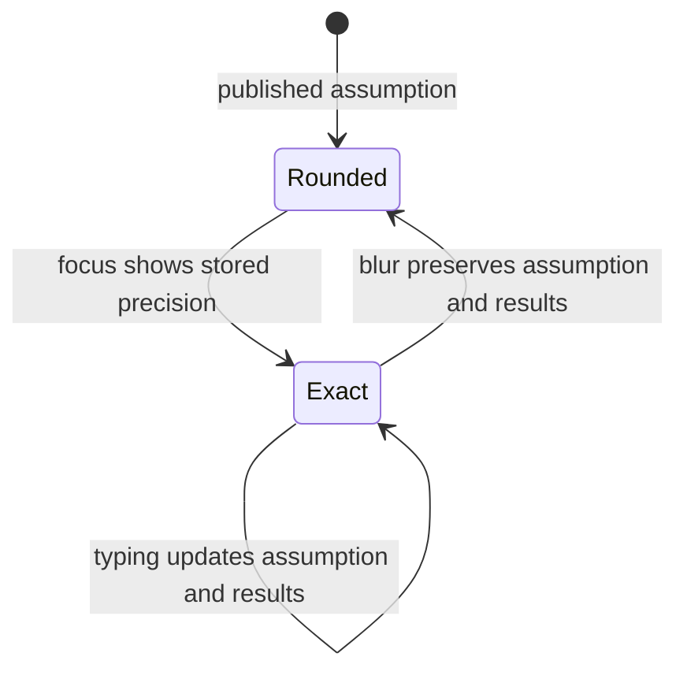

# Ownership modeler system design

Card: WR227.S14.J1. Medium, one session. Sources pinned to DoctorCRE/carr-system `865fefee26fcbbe50a04c7515c5f3d3bc8913cd1`. App base `28a1a144cc6659b83617a19f06f504332570fe38`.

Architecture uses an injected validated publication and property-opening callback. The React module owns ephemeral draft strings and chart selection. The pure model owns eligibility, validation and calculations. No sibling router, package parser, dialog or bundler changes. The structural property projection matches S11 `purchases-package.ts` at `1bc3bd88`.

Two designs considered were mutable per-property models with cached results, and a reducer plus pure calculations. The reducer avoids cache invalidation and keeps invalid drafts separate from valid output. Model the Domain determined this choice.

Capacity is 120 monthly steps per property. The fixture has one eligible property; 10x requires ten independent 120-step calculations. Property count is the first scaling limit. There is no network fan-out, cache, storage access, N+1 query, queue, retry or send. External-call circuit breakers, rate limits and write idempotency are n/a because there are no external calls or writes. React derives results sequentially. Invalid input refuses results. Missing ownership renders nothing. Publication replacement and reload restore defaults. Tests cover these rules, finite output, immutable publication and absence of requests/storage.

## Calculation conventions requiring reference review

The design names amortisation, collection, lease-up, appreciation, contributions and equity but does not provide the reference holdingPoint implementation. Synthetic methods are placeholder text. Exact reference methodology and visual parity remain unproven.

Financing covers acquisition only. Practice buildout and outside TI are paid at acquisition. Fixed monthly payments amortise debt; zero interest divides principal by term. During lease-up, published existing income is capped at full outside rent. After lease-up the outside area earns modelled rent. Collection applies to both periods. Appreciation compounds annually. Contributions equal acquisition cash plus debt service less outside collections. Practice lease cost equals lease rent plus lease buildout. No expenses, tax, sale costs or escalation are modelled. Negative carry remains a surplus. Currency rounds only for display. All these conventions appear in the UI.

Derived defaults use the greater of program share and minimum area/building area; TI uses the first published option. Practice lease rent and lease buildout start at the corresponding published rent/buildout defaults. Eligibility conservatively requires a candidate fee-simple whole-building offering with positive price and enough contiguous available space. Nonstandard tenure/offering requires verification.

## Statechart

Unknown selections preserve state. Property selection resets property assumptions while retaining each property's occupancy allocation. Chart selection never changes finances. Transition tests exercise these paths. The bounded TLA+ draft abstraction reached three states and nine steps. MemoryOnly, ValidResults, InvalidRefuses and NoDeadlock held. It omits numeric finance and DOM rendering; the model tests and browser tests cover those. Its generated chart hides three self-transitions. Run the installed statechart skill against `test/models/ownership/Draft.tla`, with `--config test/models/ownership/Draft.cfg` and a fresh output directory. The generated chart and report are retained beside the model.

## Design and debt pass

Codebase-design selected a pure calculation interface shared by the component and tests, with property-opening injected at the real S11 seam. Zero-tech-debt removed indirect table lookups and kept derived results out of state. No existing ownership implementation or compatibility caller exists on the base, so there is no obsolete model to remove. The addition implements the optional ownership behavior and its synthetic tests. No comments or lint suppressions were added; no-comments was applied directly under the no-children instruction.

## Integration and production proof

S10 owns registration, strategy route and bundling. S11 owns the property dialog. Inject onOpenProperty after those interfaces are pinned. Review A-S16..A-S25, A-T40..A-T56 and A-L80..A-L94 against private references before claiming parity. Synthetic tests do not establish private parity or production. Production proof must change an assumption in a deployed publication, compare every dependent output, and reload to defaults without server writes.

## Throughput checkpoint

Blocking work is source/schema and overlap inspection before edits. Tests and implementation share one owner. No state is shared outside the component. One worker is the smallest safe decomposition. No subagents.

## Review corrections

Card: WR227.S14.J4. Small, two view-layer defects. The chart summary compares the same two series used to draw its polylines. Currency controls own focus state only. Focus shows the raw draft; blur formats the displayed value without dispatching a financial edit. The reducer remains the sole owner of the assumption. Tests compare the summary with SVG points and compare every results table before and after blur.

The alternatives were to quantize accepted financial inputs or preserve precision and format only the control. Presentation-only rounding requires the latter. No calculation interface changes, cache, persistence, requests, queues or new external dependencies are needed. Capacity and failure behavior remain as described above.

The regression reopens the field to verify stored precision and checks the synchronized control. Reducer tests also cover invalid-to-invalid edits and recovery through selection and reset. No additional formal-model claim is made for focus formatting.

Throughput checkpoint remains one owner with no shared state. The two browser regressions failed before the fix in commit 173ede92. No-comments and design alternatives were checked directly because this job forbids subagents. No comments, casts, suppressions or compatibility paths were added.
