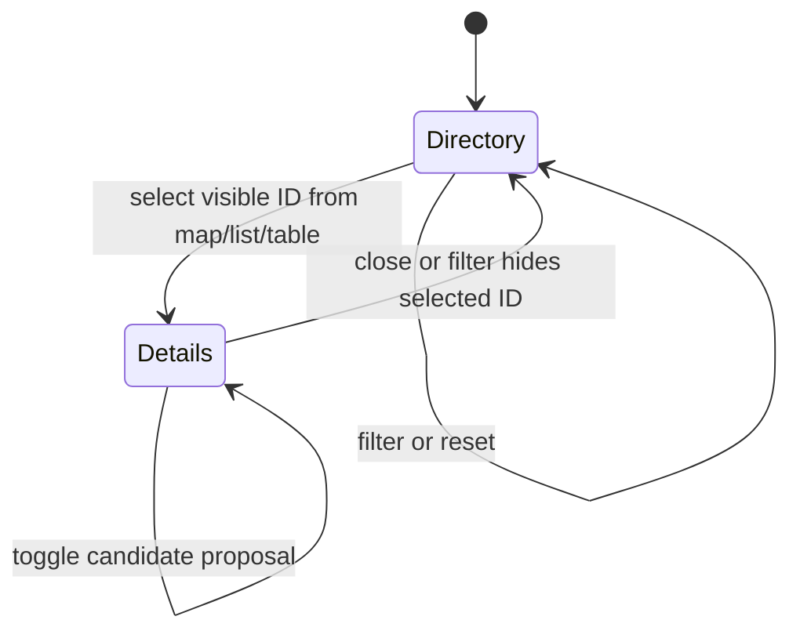

# Purchases system design

Card: WR227.S11.J1

Medium scope. One owner, one module, injected synthetic package and DOM tests.

## Grounding and alternatives

Current main 28a1a144cc6659b83617a19f06f504332570fe38 has no portal shell.
S10 PR 665 at 810ee721592386fa8f55c48552e0c1002e628c79 owns routing,
common package types, renderer and bundling. Its PortalModule accepts route,
label, available(publication), render(publication). Purchases exports that
structural interface without changing S10 files. Integration waits for S10.
The input is a structural projection of carr.market-study.v1 at CARR revision
865fefee26fcbbe50a04c7515c5f3d3bc8913cd1, with the unchanged synthetic schema
and package committed alongside tests. Replace the local projection with Pick
of the landed common type during integration; do not keep two type authorities.

Alternative A duplicates map, directory and table selection states. Rejected
because filters and context exclusion can diverge. Alternative B owns one
selected property ID and one filter state; every view derives from them.
Selected B. Package property ID is identity; display number is never identity.

## Throughput checkpoint

- Blocking first steps. Read pinned schema, live map architecture 1.2.0 and S10.
- Independent workstreams. None. One cohesive module in a single worker checkout.
- Shared mutable state. No shared files changed. Publication is immutable input.
- Smallest safe decomposition. One worker owns map, directory and transition tests.

## System design

Architecture. Purchases owns filtering, selection, dialog and local proposal IDs.
The host owns publication loading, session lifetime and persistence. Optional
proposal callbacks describe a desired selection; they never call CARR. Map and
list share immutable IDs and filtered records. Test through module and DOM seams.

Capacity and scaling. Work is O(n) per filter or selection. At today's synthetic
two properties and 10x, one bounded publication fits in memory. At large n, DOM
and marker layout break first; publication contract should bound input, then
paginate before increasing the limit. No unbounded polling or background jobs.

Load spread and caching. No backend fan-out. Browser loads one self-hosted map
library and two package layers. Asset URLs use content hashes, so publication
changes invalidate them. No application cache, eviction or stale publication.

Availability and circuit breakers. Directory renders before optional map startup.
Any library, layer or map error opens a one-failure breaker for that mounted map,
removes it and exposes a status. No automatic retry. Unmount removes map resources.
Photos have visible failure fallbacks; absent plans produce no dead link.

Storage and N+1. No storage reads or writes. Assets are requested lazily by the
browser, by immutable hash, with no per-property API calls. Sources require safe
HTTPS URLs and no embedded credentials. Unsafe assets are omitted.

Consistency. Selection, table and map derive from the same package. Filter changes
close hidden selections. Context properties never enter proposals. Duplicate IDs
refuse rendering. Publication replacement remounts local state.

Async. Only optional map startup. No queue, producers, consumers or external sends.
Map cleanup fences a late library import. No retries, loops over network calls,
or persistence. Proposal toggles are desired-state callbacks keyed by property ID.
Rate limits and idempotency for writes are n/a because the module performs none.

## Statechart

Map region runs in parallel. Starting moves once to Ready or Unavailable.
Ready moves once to Unavailable on error. Unmount disposes either state.
Context toggle is a self transition with no proposal change. Hidden or unknown
IDs are ignored. Filter reset clears selection and restores all records.
The model omits browser rendering, network transport and host proposal persistence.

## Verification limits

Synthetic tests cannot establish private-reference parity or production behavior.
S10 integration and deployed published-portal proof remain coordinator work.

TLC executed the committed model. It reached 48 states and 492 steps with
SelectionVisible, ContextExcluded, DirectorySurvives and NoDeadlock holding.
Run the pstack statechart command against test/models/portal-purchases/Purchases.tla
with a fresh --out folder to reproduce. The model has no retry transition.

## Design and debt pass

codebase-design. Chose one ID-based state owner behind a publication input and
proposal callback. Rejected independently mutable map/list/table selections.
zero-tech-debt. No route aliases, feature flags, persistence adapter or duplicated
shell files. The provisional projection must become a Pick of S10 common types
when S10 lands. Vector styles and shared marker-spacing remain S10/S16 integration
work; unsupported basemaps use the visible directory fallback.
