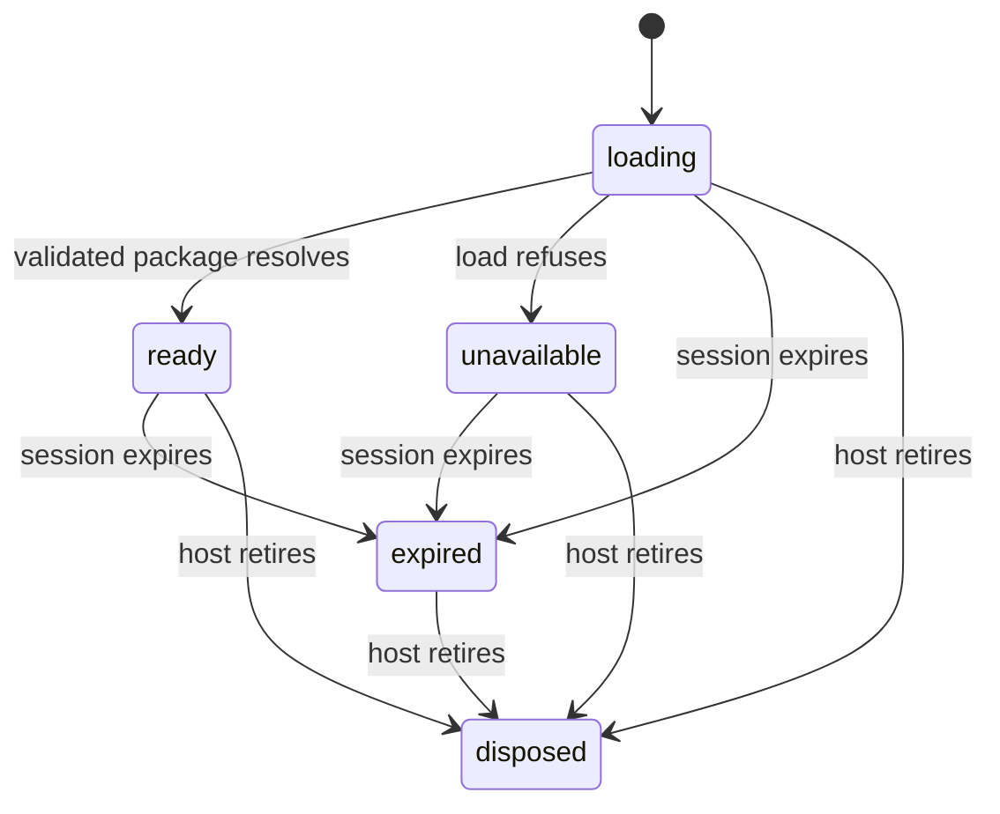

# Market study shell

Card: WR227.S10.J1

## Interface and contract

The shell consumes a fully validated `carr.market-study.v1` publication.
`mountPortal(container, {load, modules})` owns publication lifetime, cancellation
and rendering. `load({signal})` returns a validated `MarketStudy` or rejects.
The S9 host owns session authentication, fetching `package.json`, validation,
publication consistency and refusal classification. No credential or transport
is implemented in this module. S9 must invoke this interface after sign-in.
`mountMarketStudy` is the synchronous interface for an already validated package.
Both return an idempotent `dispose` method.

`PortalModule` registers a typed route, title, data-presence predicate and React
renderer. The shell evaluates availability before navigation or rendering and
mounts only the active renderer. S11, S12 and S13 can own their modules without
editing the router. No hypothetical fallback implementations are registered.
Home and Sources always exist in the full schema. The shell makes no CARR writes.

The authoritative schema and unchanged synthetic fixture are copied from
DoctorCRE/carr-system commit `865fefee26fcbbe50a04c7515c5f3d3bc8913cd1` into
`test/fixtures/portal`. Common types were generated with json-schema-to-typescript,
with its draft-2020 tuple and conditional-basemap gaps corrected to `[number,
number]` and a discriminated union. The test validates the fixture with AJV 2020.
The app base inspected was `28a1a144cc6659b83617a19f06f504332570fe38`.

## System design

Architecture uses a publication host, a single fragment router, a data-gated
module registry, Home, Sources and a lazy local-layer map. React owns the DOM.
The host owns only this browser's publication lifetime. Package and file storage,
sessions and writes remain server responsibilities.

Capacity is linear in visible records. Current fixture renders one development
and one context anchor. At ten times that count, DOM cards and map markers grow
linearly; rendering and marker collisions break first, before network fan-out.
There is no record-per-request loading. Map files load as two GeoJSON sources.
Module renderers are lazy by active route. Browser tests cover phone and desktop.
No claim of measured performance or private-reference parity is made.

Load spread is one package read via the injected host, followed by the active
view and its map. There is no background refresh, worker queue or parallel
record fan-out. N+1 database access is n/a because the UI has no database access.
The full package is immutable for the mount. It is held in memory, never browser
storage, and evicted on expiry, page retirement or disposal. Failed loads refuse
rendering, and late loads cannot restore expired content. Unit transition tests
cover loading, ready, unavailable, expired and disposed states.

The only direct external operation is the self-hosted MapLibre module load and
its two same-origin file sources. One failed import or map error removes the map
and shows an accessible fallback; the directory stays usable. There are no
retries or background loops. Vector styles refuse here pending S16's provider
rights and renderer work. A host loader is called once and receives cancellation;
its transport timeout and refusal policy belong to S9. No write or send exists,
so idempotency keys are n/a; disposal itself is idempotent.

The two interface candidates were a router with embedded views and a registry
of typed renderers. The registry keeps future slice ownership local and prevents
inactive modules from rendering. It does not add a second router or mode flags.
The throughput checkpoint used pinned contract and overlap inspection first,
one worker for the common package and bundler, no shared writes, and sequential
integration checks. No children were used.

## Statechart

The checked TLA+ model is in `docs/portal-model`. TLC reached five states and
thirteen steps. NoRetiredPublication, ReadyIsVisible and NoDeadlock held.
Four self-transitions are omitted from this chart.
The model covers publication lifetime, not map internals, server validation or
the browser's native history stack. History and dialog behavior have DOM tests.
The lifecycle model was written before the async host, after the initial
synchronous renderer. The initial renderer was not modeled before coding.

Run the installed pstack statechart script with `docs/portal-model/Portal.tla`,
`--config docs/portal-model/Portal.cfg`, `--view docs/portal-model/view.ts` and a
fresh `--out` directory. The model has no production effects.

## Scope and proof limits

The pinned fixture contains a Candidate sites snapshot, conflicting with the
current instruction that property counts and rents belong on Purchases. Home
conservatively omits snapshot labels naming candidates, properties, listings,
sites, rents or asking amounts. This is presentation filtering, not a claim
that the schema encodes metric categories. Typed metric categories require a
future coordinated schema revision if other packages use different labels.

This is a partial S10 builder handoff. Reference CSS, asset and interaction
parity is unproven. The Studio must run the assigned S10 rows using the private
publications after S7/S9 land. Map anchor/practice markers and focus/hover previews are implemented.
Stems, scroll progress and resize-aware header tracking are implemented and
covered by the shell browser suite. Exact reference styling remains unproven. Local-layer MapLibre and development markers use the existing
self-hosted 6.4.1 assets; vector basemaps remain S16. No approximate coordinate
is exposed as navigation.

`portal/index.html` is an inert adapter-owned host entry, not a second sign-in.
The synthetic DOM host in the browser test calls the exported module with the
committed fixture. Existing app URLs, passwords and roadmap are untouched.
The deployed portal proof remains pending. After integration and release, verify
the published Home headline and snapshot, open Sources, exercise browser history,
and confirm no internal notes appear. A local fixture cannot attest this.

## Fixture styling verification

The remainder round adds development image previews, spaced Sources cards,
explicit heading and paragraph rhythm, and navigation targets of at least 44px.
The existing module and adapter interfaces remain unchanged. Browser checks run
Home and Sources at 390px and 1280px in both themes, including a four-property
Sources grid. These checks prove fixture layout, not reference pixel parity.

The earlier cancelled CI run failed its aggregate receipt gate because the
shards had no complete receipts. The same missing-receipt input is refused by
both this branch and origin/main. A later hosted run on the unchanged initial
head passed every job, including all shards and performance:
https://github.com/jbookout/doctorcre-app/actions/runs/41977014209.
