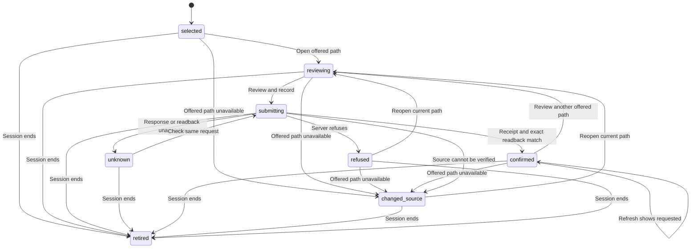

# Requested introduction

Card: WR591.S26.J1

Medium app-only slice. No subagents per dispatch. Two designs considered before code: a form embedded in each connection, and one retained review dialog. The retained dialog keeps an uncertain request when the user closes and reopens a path. The existing snapshot owns offered-path eligibility.

System design: one typed review module owns form state and the retained request. The live client owns authenticated, session-bound MCP transport. Before dispatch read the snapshot and compare the exact path. After a receipt read back the exact canonical edge. Current and 10x load use one preflight read, one validation readback and the existing network refresh per user write, with no fan-out, queue, new cache, database access or N+1 loop. Display freshness uses the existing 120-second snapshot. A failed call stops until user action. Existing transport deadlines bound external calls. Same-key recovery has no automatic retry. Recovery first reads a fresh canonical snapshot. An exact committed requested edge permits same-key reconciliation even after the offer is suppressed; otherwise the original offered path must still pass current eligibility and identity checks. Failed reconciliation retains unknown intent. Preflight 401, 403 and session_changed retire the review and clear private identities and notes.

Never send on open. Never mint a second key for an unknown request. Never apply late results to a retired view. link-parties has no source-version argument, so a pre-write read cannot provide atomic source fencing. Server authority remains unchanged.

Producer fixtures were recorded on Studio at carr-system 9d8242f399eef0269dc0d74773b40ad98ad45685. The real registered TOOLS link-parties handler ran with a strict synthetic query adapter and no database connection. The real projectNetwork function projected synthetic rows. test/fixtures/introduction-request.json retains new, replayed and existing receipts plus offered and requested snapshots. State and browser tests consume these through the production receipt parser, network validator and live transport. No production record was written.

Transition-to-test mapping:

| Transition | Executed test |
| --- | --- |
| Selected to reviewing, reviewing to submitting to confirmed | selected path requires explicit review and preserves exact party identities |
| Submitting to changed source | fresh source refuses restricted/hold/stale/changed/removed/already-requested |
| Submitting to changed source after a failed read | an unavailable fresh read blocks writing without claiming the source changed |
| Changed source to reviewing | changed source requires reopening and explicitly reviewing its current identities |
| Selected/reviewing/refused/confirmed/changed source to changed source on open | unavailable offered path stays unwritable from each review state |
| Confirmed to reviewing | a recorded request can return to review without duplicating its write |
| Submitting to refused, refused to reviewing | server refusal remains refused and reopening requires a new review |
| Submitting to unknown, unknown to submitting to confirmed | lost response blocks replacement and recovers with identical key after reopening |
| Confirmed to confirmed on refresh | V03 explicitly reviews and records the exact introduction, all widths/themes |
| Submitting to retired | retirement suppresses a late receipt and all later sends |
| Other active states to retired | retirement clears selected/reviewing/unknown/refused/confirmed/changed_source review and prevents further sends |
| Unknown to submitting to unknown on failed reconciliation | uncommitted recovery revalidates restricted/removed/stale/changed/already-requested before any new write; unavailable recovery read retains unknown intent until reconciliation can finish |
| Unknown to submitting to confirmed after offer suppression | committed recovery remains possible after offer suppression and endpoint restriction |
| Preflight session refusal to retired | preflight session refusal clears the review; retirement ignores a pending preflight that resolves/rejects later |
| Transport session change to retired | transport session refusal retires and clears the retained review; V03 changed-session recovery sends no second write and clears private review identities |
| Read-only proof and cancel | V03 proof observation passes exact identity |
| Proof identity mismatch | V03 proof observation rejects near-miss identity |

The proof CLI checks a containing release, opens the canonical offered path at 1440 and 390 in both themes, compares every displayed identity and evidence field exactly, and cancels without sending. Persistence is covered by synthetic browser transport tests. A production requested-status receipt requires a separately authorized business request. Independent taste scoring belongs to the reviewer.

The clean release fixtures exposed an eager import from LiveClient to the generated introduction bundle. Three approaches were compared: load the parser when link-parties returns; generate every UI asset before all Node checks; duplicate the receipt validator in the transport. Loading only at the new operation keeps clean-source imports independent of generated UI and preserves one parser. The existing release-publication tests enforce this boundary. Dynamic import starts loading when the import call executes, as specified by [ECMAScript import calls](https://tc39.es/ecma262/multipage/ecmascript-language-expressions.html#sec-import-calls). The browser artifact still includes the registered UI entry through the existing build.

The guarded model is in introduction-request/IntroductionRequest.tla with its configuration and TypeScript mapping. It bounds one endpoint triple, two intended requests and two network attempts. It assumes the deployed server's same-key replay and unique relationship contract; it does not prove database concurrency, availability or an atomic source fence. Source inputs are nondeterministic at reads. The model checks these rules in addition to TypeOK:

| Invariant | Executed behavior test |
| --- | --- |
| NoUnreviewedDispatch | selected path requires explicit review and preserves exact party identities |
| NoUncheckedDispatch | fresh source refuses restricted/hold/stale/changed/removed/already-requested; unavailable fresh read blocks writing |
| NoNewKeyWhileUnknown | lost response blocks replacement and recovers with identical key after reopening |
| NoUnverifiedConfirmation | receipt and exact canonical readback are both required; complete proof runner fails an exact identity mismatch |
| NoDispatchAfterRetirement | retirement suppresses a late receipt and all later sends |
| NoPrivateViewAfterRetirement | V03 retiring the review clears private notes and prevents reopening their values |

Run the installed statechart script with `from-spec docs/verification/introduction-request/IntroductionRequest.tla --map docs/verification/introduction-request/map.ts --out /tmp/intro-guarded-chart --png`, with Java and TLA2TOOLS configured. The phase diagram above remains the direct transition-to-test index.
