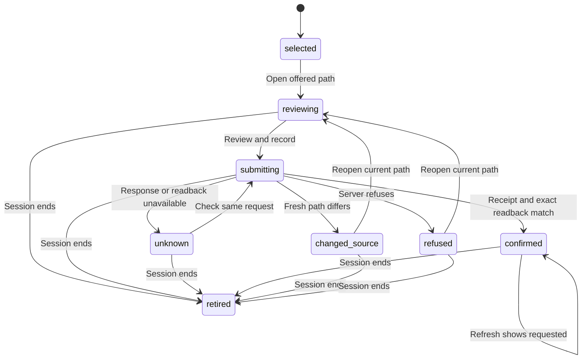

# Requested introduction

Card: WR591.S26.J1

Medium app-only slice. No subagents per dispatch. Two designs considered before code: a form embedded in each connection, and one retained review dialog. The retained dialog keeps an uncertain request when the user closes and reopens a path. The existing snapshot owns offered-path eligibility.

System design: one typed review module owns form state and the retained request. The live client owns authenticated, session-bound MCP transport. Before dispatch read the snapshot and compare the exact path. After a receipt read back the exact canonical edge. Current and 10x load add two bounded reads per user write, no fan-out, queue, new cache, database access or N+1 loop. Display freshness uses the existing 120-second snapshot. A failed call stops until user action. Existing transport deadlines bound external calls. Same-key recovery has no automatic retry.

Never send on open. Never mint a second key for an unknown request. Never apply late results to a retired view. link-parties has no source-version argument, so a pre-write read cannot provide atomic source fencing. Server authority remains unchanged.

Producer fixtures were recorded on Studio at carr-system 9d8242f399eef0269dc0d74773b40ad98ad45685. The real registered TOOLS link-parties handler ran with a strict synthetic query adapter and no database connection. The real projectNetwork function projected synthetic rows. test/fixtures/introduction-request.json retains new, replayed and existing receipts plus offered and requested snapshots. State and browser tests consume these through the production receipt parser, network validator and live transport. No production record was written.

Transition-to-test mapping:

| Transition | Executed test |
| --- | --- |
| Selected to reviewing, reviewing to submitting to confirmed | selected path requires explicit review and preserves exact party identities |
| Submitting to changed source | fresh source refuses restricted/hold/stale/changed/removed/already-requested |
| Changed source to reviewing | changed source requires reopening and explicitly reviewing its current identities |
| Submitting to refused, refused to reviewing | server refusal remains refused and reopening requires a new review |
| Submitting to unknown, unknown to submitting to confirmed | lost response blocks replacement and recovers with identical key after reopening |
| Confirmed to confirmed on refresh | V03 explicitly reviews and records the exact introduction, all widths/themes |
| Submitting to retired | retirement suppresses a late receipt and all later sends |
| Other active states to retired | retirement clears reviewing/unknown/refused/confirmed/changed_source review and prevents further sends |
| Transport session change to retired | transport session refusal retires and clears the retained review; V03 changed-session recovery sends no second write and clears private review identities |
| Read-only proof and cancel | V03 proof observation passes exact identity |
| Proof identity mismatch | V03 proof observation rejects near-miss identity |

The proof CLI checks a containing release, opens the canonical offered path at 1440 and 390 in both themes, compares every displayed identity and evidence field exactly, and cancels without sending. Persistence is covered by synthetic browser transport tests. A production requested-status receipt requires a separately authorized business request. Independent taste scoring belongs to the reviewer.
