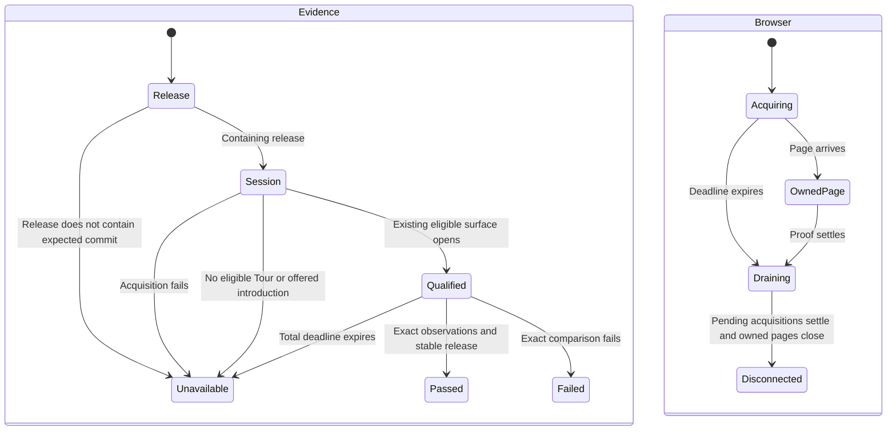

# Proof runner lifetime

The introduction proof loads the app once, switches theme using the shell control, and reviews and cancels at both widths. It takes `--expected-commit`. The Tour drag proof accepts either a shared `--cdp-url` or a private `--storage-state` file. CDP does not export session state.

The Tour proof requires an existing editable Tour in its deal workspace with two flexible stops. A legacy standalone route-editor URL does not satisfy that acceptance. The proof never creates a Tour or saves a reorder. Missing qualification exits 78 and names the missing evidence.

Never close a pre-existing shared page or browser. Never disconnect while an acquired page is still pending. Never report an assertion failure for missing release, session or Tour evidence. This chart describes lifecycle coverage, not a formal interleaving proof.

The shared release containment tests cover equal, descendant, older, unrelated and unknown commits. `Tour proof shared CDP CLI pass`, `near-miss`, `legacy` and `unreachable` cover the verdict paths. `Tour proof deadline cleans late page`, `late launch` and `stalled evaluation` check cleanup through fresh CDP connections while preserving a sentinel tab. The existing introduction deadline cases cover late launch and stalled evaluation. `V03 paced proof finishes within the original total deadline` checks all four observations with serialized 110ms fixture dispatches.

System design uses the existing signed-in browser owner and release reader. Each proof has one total deadline and no retries, fan-out, production writes, queues or new storage. Introduction downloads are reused only during the run; independent relationship reads remain fresh for every comparison. Tour canonical reads still reload after Undo. The 300-request Tour cap and 30-second introduction deadline remain unchanged. At ten times the page size, the deadline or request cap refuses evidence rather than extending the run. Acquisition failure exits 78; cleanup drains late acquisitions before disconnecting. No new runtime API or database contract is introduced.
