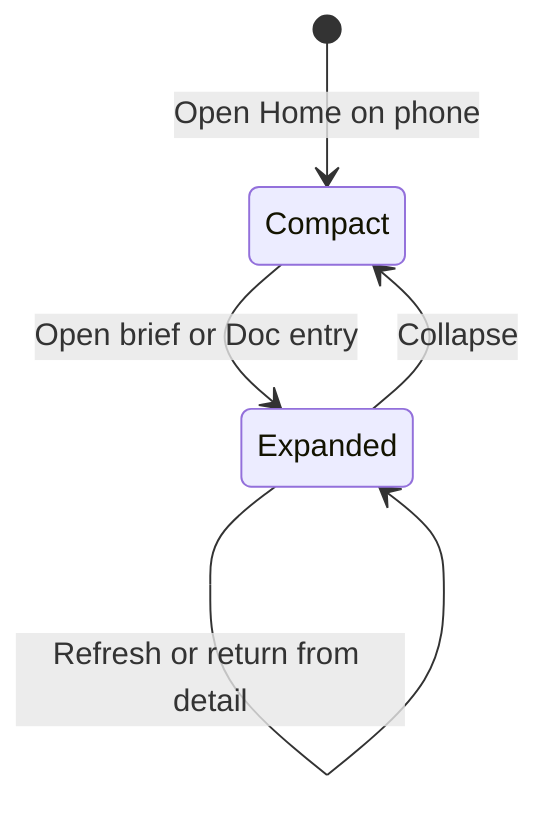

The visible chart models reading, ready, partial, unavailable, queue detail, record detail, refresh and retirement. TLC checked 7 states and 19 transitions. SharedRead additionally checks PrivateFactsCurrent across two session generations, coalesced reads, success, failure and late completion. TLC checked 9 distinct states and 19 generated states with no errors.

Regenerate with JAVA=/opt/homebrew/opt/openjdk@21/bin/java and TLA2TOOLS pointing to tla2tools.jar. Run the pstack statechart script `from-chart brief.mmd --module InlineBrief`. Run `java -cp "$TLA2TOOLS" tlc2.TLC -config SharedRead.cfg SharedRead.tla` for the read lifetime.

Transition coverage uses these named tests.

| Transition | Test |
| --- | --- |
| Reading to Ready | Home mounts the shared brief inline without a blocking dialog |
| Reading to Partial | F6 partial and missing required sources are visible using safe category names |
| Reading to Unavailable | failed and malformed reads do not consume daily opening, supported refresh recovers automatically |
| Ready and Partial to Reading | F1 full brief coverage makes Needs Joe, accounts and providers reachable without an all-clear |
| Unavailable to Reading | unavailable brief recovers on background read, clears prior facts, partner changes never reuse content/preferences |
| Ready and Partial to Queue | brief exposes all four queues and reaches the 51st loop in server order with honest counts |
| Ready and Partial to Record | Home brief stays inline with inbox and restores priority focus in both themes and widths |
| Queue to Ready | rendered brief queues show the 51st tied loop and retain readable narrow-screen controls |
| Record to Ready | task title repeats stay omitted in sections and detail while refreshed instructions remain visible |
| Reading to Retired | rail and inline owner coalesce reads and retire late private responses |
| Ready, Partial, Unavailable and Record to Retired | F4 suspended brief clears detail and fences late reads before joe recovery |
| Queue to Retired | suspension clears paged queue facts and fences late pages before joe revalidation |
| Retired to Reading | F4 suspended brief clears detail and fences late reads before dell recovery |

The chart abstracts source contents, DOM layout and transport timing. Browser tests cover layout and preserved inbox selection, waiting-person draft and priority focus. The shared-read model bounds session change to one retirement and does not model transport cancellation, which uses the existing current-read lifetime tests. A partial result returning from detail may remain partial; Ready in the chart means the brief list is visible, with its coverage still explicit.

Explicit rail refresh uses SharedRead's existing Read action even when shown is current. Ordinary cached reads and in-flight coalescing do not change the modeled state. The transition set and invariants are unchanged. The test "explicit refresh bypasses a recent brief while ordinary readers coalesce" covers this read-owner contract. "Preparation close preserves the unrelated layout board and triage refresh" covers the rail caller.

Phone presentation is an independent disclosure state. The mounted brief remains intact in both states, so refresh and detail return do not change disclosure state.

"Home brief stays inline with inbox and restores priority focus in both themes and widths" covers compact inbox visibility, expansion and retained state. Desktop always shows the brief; the disclosure control is phone-only. Direct #homeBrief entry starts expanded.
