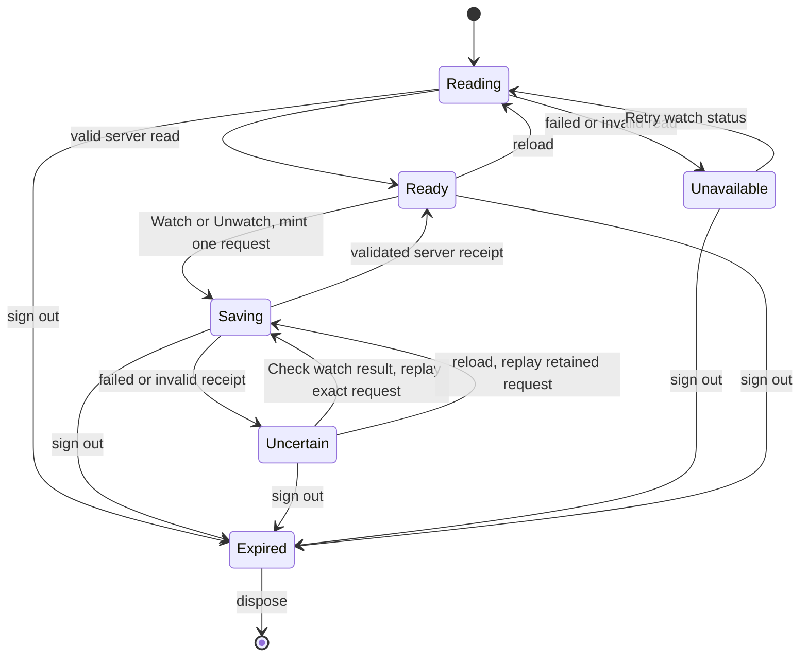

# Workspace watch statechart

The workspace mounts `mountSubjectWatch(element, { subject, actor, client })`.
CARR owns subscriptions, visibility, baselines and notification policy.

Ready contains the validated server watch or null. Reading and Unavailable never
render Watch. Saving does not optimistically change status. Uncertain permits
only exact-request replay. Generation tokens reject results after disposal or
sign-out. Pending requests survive reload in actor-scoped session storage.
Subscription state is never stored in the browser. Sign-out clears the request.

Tests follow these transitions at 390 and 1440 pixels in both themes. Late reads
and writes after disposal or sign-out cannot restore private state. Tests cover
failed reads, keyboard focus and reload persistence through the mounted interface.

Two designs considered. A workspace-owned reducer would spread async lifecycle,
replay and auth across legacy JavaScript and React. The chosen island keeps these
behind one mount/dispose interface with injected client methods.

Fixture bytes come from CARR commit 3ea487f1c8944af6dc8bb7337c9ae3aac1d214bd.
Its embedded source_commit names an earlier implementation commit and is preserved.
Listing is refused by this contract. The workspace has no canonical lease ID,
so it mounts only its canonical deal UUID. Lease callers can use the same typed
interface when their UUID is available. No recurring reads or change evaluation.
